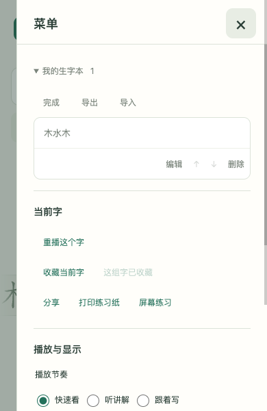

# Web 侧边抽屉与滑动切字

日期：2026-11-08。用户要求将低频操作收进右上角侧边抽屉，移除旧版入口、取消笔画定位，并加入大字格左右滑动切字。本地已实现，未部署。

## 页面与抽屉

页首右上角为菜单图标。主页面不再显示生字本、展开设置或旧版链接；保留搜索／历史、拼音与笔数、居中画布、播放、前后笔和字导航。按编号笔画列表与“重播本笔”已移除，控制器原有逐笔状态仍供上一笔／下一笔使用；历史 `/legacy/index.html` 文件保留兼容，不在新版提供入口。

右侧模态抽屉包含生字本、当前字工具和播放／显示设置，桌面最大 400px，手机保留 24px 遮罩区域。抽屉内容独立滚动，展开生字本不改变主页面高度或画布中心。通过原生 dialog 实现模态与背景隔离，补充 Tab／Shift+Tab 首尾循环；支持关闭按钮、遮罩及 Esc，关闭返回菜单按钮。

- 查询前也能打开菜单、导入生字本或调整设置；没有查询时隐藏当前字工具、禁用不能执行的操作。
- 打开菜单暂停演示／练习，关闭后不自动继续，避免错过正在播放的笔画。
- 选清单、进入练习、打印、重播及全屏会关闭抽屉；清单加载后聚焦播放控制，不强制聚焦输入框弹出手机键盘。
- 收藏、管理和调整设置保留抽屉；编辑、导入确认、分享作为其上层对话框，取消上层只回到抽屉。删除最后一项将焦点移到可用的导入按钮。
- 专注布局仍保留右上角菜单；退出专注按钮与其错开，键盘 Esc 优先处理当前对话框。

## 滑动规则

只在大字格区域使用 Pointer Events。左滑下一字、右滑上一字，沿查询快照的索引切换，保留重复字；到首尾不循环，不触发无效播放或重载。

识别要求横向位移至少 40px，按画布宽度适度增加且最多 72px，并明显大于纵向位移。短拖动、先纵向滚动、取消的指针、多指动作及操作按钮不触发切字。保持 `pan-y pinch-zoom`，不在整页阻止滚动或缩放。输入开始时由画布捕获指针，忽略子 SVG 路径隐式捕获转交的冒泡 loss 事件，避免正常手势被误取消。

切字复用原有取消／加载流程：先停止旧动画与声音，再显示目标完整字形，不自动播放；沿用候选队列轻量动画，前后方向一致。查询或索引变化、打开菜单、进入后台、页面离开、尺寸变化和切换练习状态均清除未完成手势。屏幕练习期间（含暂停和完成态）不响应滑动切字，保留手写操作；仍可使用前后字按钮。

## 验证与限制

- `npm test`：48 字／233 笔样本、58 项 Node 回归通过。新增手势距离／方向、取消、查询变化、练习禁用、多点及 SVG 捕获转交回归。
- 四入口生产构建、语法与 diff 检查通过。没有新增依赖，未改动既有用户的旧版源文件或本地字形目录。
- Headless Chrome 156.0.8078.80，抽屉／手势专项检查：查询前菜单、焦点循环与 Esc；主页面高度／中心稳定；嵌套编辑及选择清单后的焦点；原生触控左右切字、重复字和首尾；鼠标短拖动阈值；手机抽屉高度与遮罩关闭；播放中切字取消；练习输入不误切、菜单暂停练习；最后一项删除后的有效焦点。未捕获页面异常为 0。
- 生字本 6、分享 5、打印 6、拼音 3、练习 8 组既有流程通过；首页 9 项流程通过，包含完整 4 笔录音播放、前后笔、收藏兼容跳转及旧地址直接访问；演示三视口坐标差为 0，保留无 viewBox 的反例。打印脚本的 reload 等待已修正为空 DOM 可等待，未削弱许可故障断言。

完整本轮记录见 [验收记录](验收记录/drawer-swipe-2026-11-08.json)。

此前 Headless Chrome 156.0.8078.80 的原生纵向触控及短距离触摸调用曾回执超时，过程中可见 pointercancel、页面位移及 hidden，历史记录保留该阻塞；默认脚本仍提供鼠标／滚轮检查，不用它替代原生触控。

**2026-11-08 CDP 复测：** 用户要求再试后，连接其提供的 `127.0.0.1:9223`，Chrome 156.0.8078.81，在同一生产预览完成 `--native-scroll` 和新增 `--native-touch` 两轮专项，每轮 8 组流程通过，未捕获异常为 0。18px 原生短触摸不切字；左右触控按索引切换并保留重复字；原生纵向触控滚动请求正常结束、页面发生滚动且当前字不变。此前阻塞在此环境未复现，不能据此确定旧环境的根因。完整结果见 [9223 复测记录](验收记录/drawer-swipe-cdp-9223-2026-11-08.json)。

上述结果是 Chrome 移动视口模拟及注入触控事件，不是实体触摸屏或 iPhone／iPad Safari；双指缩放和系统文件面板仍未在本次验证，保留真机专项边界。

```bash
node test/browser-drawer-swipe.mjs <CDP地址> <生产首页地址>
# 原生纵向触控滚动（旧 Headless 环境可能超时）
node test/browser-drawer-swipe.mjs <CDP地址> <生产首页地址> --native-scroll
# 原生短拖动和纵向滚动全量复测
node test/browser-drawer-swipe.mjs http://127.0.0.1:9223 http://192.168.6.169:5188/ --native-touch
```


