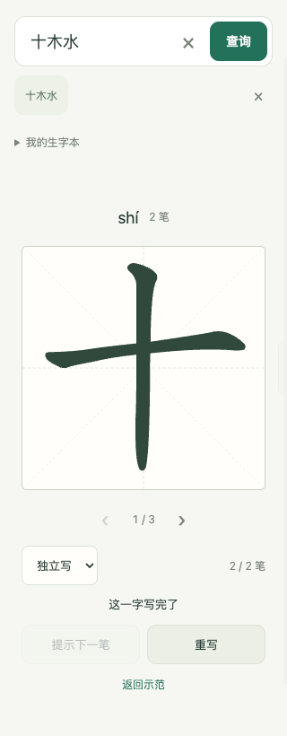

# Web 屏幕练习原型（F5）

2026-11-11 最新调整见 [功能精简](Web功能精简.md)：独立专注模式和二维码已取消；屏幕练习改为画布下方入口；收藏统一入口，管理／播放设置／打印参数按需展开。下文保留原交付记录。


日期：2026-11-09。已实现单字输入与连续练习，未部署。用户已确认 iPad 和 Apple Pencil 输入正常；新增连续流程和 iPhone 输入仍保留专项验收边界。

## 使用与范围

查字后展开“右上角菜单 → 屏幕练习”，停止原演示与声音，沿用并适当放大居中的大字格。拼音与笔数仍在上方；练习面板替代原播放面板，提供描红／背临、提示下一笔、重写、返回示范。

描红显示淡色轮廓，背临隐藏轮廓；切换方式从头重写。按当前顺序匹配大致轨迹，正确后填入标准笔画，不评书法美观度。错误保持原进度，提示再试和下一笔索引／已知笔画名；名称未知不猜测。提示只高亮下一笔，不算完成，不自动跳笔，不在多次错误后强行放行；写完当前字后可继续下一字，最后显示本次完成字数，不表示已经掌握。

只允许当前可正常加载与校验的字进入练习，不为缺字或名称／笔数冲突绕过资源校验。没有自由手写识字、自动复习、排行榜、打卡或云端记录；用户轨迹只供当前浏览器会话内判定，不写本地存储、不上传。练习方式仅会话内保留，刷新不恢复练习。

## 状态与取消

- 显式开始后准备练习；准备及提示有 5 秒预算，失败可重写或返回示范，不无限等待。
- 已完成笔画单独记录；同一笔不能重复计数，非预期序号和过早完成回调不能推进。
- 主界面的手动切字（含重复字的不同位置）、新查询、清空结束当前练习；新目标先回到示范。练习中的“下一个字”按本次顺序保留练习流程，不自动播放示范。
- 后台／页面离开、输入取消、多点触控以及画布尺寸变化暂停，取消未完成笔，保留已完成前缀；恢复前台不自动恢复输入，点击“继续练习”后从下一笔开始。
- 返回示范结束练习，恢复当前完整字形与播放控制，不自动播放。进入练习时原动画与录音先按现有统一控制器取消。
- 绘写区域内限制触摸拖动与文本选择，区域之外不全局禁用页面滚动。尺寸变化先暂停，继续时重新测量坐标。

## 实现依据

复用 HanziWriter 3.7.3 的公开 `quiz`、`cancelQuiz`、`highlightStroke`、`setCharacter`、`updateDimensions` 等接口及已加载的本站字形；另设练习状态控制器和适配器，不读取引擎私有状态。资料：[官方练习接口](https://hanziwriter.org/docs.html#quizzing)、本地锁定版本的实际实现。

实例复用：HanziWriter 每个实例会注册 document 级鼠标／触摸结束监听。本原型每页仅创建一个练习实例，重写与切字复用，避免累计注册；开始／提示串行，取消会中断等待，晚到回调不能恢复过期会话。

输入坐标使用当前画布的实际 CSS 尺寸，SVG viewBox、Writer 尺寸与指针位置统一；不能直接将动画用的 1024 单位尺寸套到触摸输入。原演示继续使用既有 1024 坐标与 viewBox。练习不新增数据源或依赖，不请求公共 CDN。

## 已验证

- `npm test`：48 字／233 笔样本、55 项 Node 回归通过；新增 7 项练习状态检查，覆盖错误与重复回调、过早完成、暂停／继续、准备中退出、切模式／目标、提示取消、超时及恢复。
- `npm run build`：四入口生产构建、字形资源准备和录音前置校验通过；修改模块语法及 diff 空白检查通过。
- 独立 Headless Chrome 156.0.8078.80，实际生产页，8 组练习检查通过：鼠标写十（错误笔顺／反向不通过）；背临及主动提示不计分、提示中重写；真实标签后台暂停／显式恢复及 CDP 笔事件；320px 注入触控写十、页面未随绘写拖动；尺寸变更暂停并重新匹配坐标；10 次重写监听数量不增长、提示中切字及返回示范；触控写木／水含撇捺与钩笔、演示中进入停止原动画、输入取消不误计；清空和新查询取消。未捕获页面异常为 0，HTTP 资源全部同源。
- 三视口演示动画坐标矩阵差均为 0，保留移除 viewBox 的反例；拼音 3 组、分享 5 组既有浏览器检查通过。

复现（Node 22+，已授权 CDP、生产预览）：

```bash
node test/browser-practice.mjs <CDP地址> <生产首页地址>
```

这些是基于标准轨迹注入的浏览器输入检查，不代表儿童实际书写的容错率、实体手写笔延迟、全字库准确性或教学有效性。此前手机核心验收不包含新增屏幕练习；建议真机先试十、木、水，再试我、线，分别检查手指与手写笔、错误笔顺、横竖屏／分屏和后台恢复，再依据实际误判调容错，不先放宽到自动通过。




## 连续练习与完成反馈（2026-11-09）

从进入时的当前字开始，按查询顺序练到末尾；从第一个字进入即练整组。从中途进入不把前面的字算作完成。“下一个字”仅在当前字写完后出现，不自动跳走，描红／背临方式沿用。当前字可“再写一次”，同一位置重写不重复累计；重复汉字的不同位置分别计数。

末尾显示“本次写完 N 字”，有跳过时另列跳过字数；提供“再练一遍”，从本次起点重新开始并清空本轮完成与跳过统计。返回示范、新查询、清空或手动切字结束本轮，不保存练习轨迹或完成历史，不关联掌握度或评分。

准备下一字期间保留已完成画布，按钮防止重复提交；加载失败或未收录明确显示目标字，可重试或主动跳过，不把跳过计为完成。若最后一个字不可用，主动跳过后仍可结束本次并重练。新查询／退出使未完成加载失效，迟到结果不能重新打开练习。等待期间打开菜单或进入后台，即使字形随后到达也保持暂停，关闭菜单／回到前台不自动启用书写。

自动复现：

```bash
node test/browser-practice-sequence.mjs <CDP地址> <生产首页地址>
```

用户反馈仅确认本轮之前的 iPad／Apple Pencil 输入正常，没有将此扩为新连续流程、iPhone 或儿童容错率的验收。

本轮验证：48 字／233 笔样本、63 项 Node 回归、四入口构建与语法／diff 检查通过。隔离 Headless Chrome 157.0.8103.39 中，连续练习 8 组、既有练习 8 组、抽屉与切字 8 组检查通过，无未处理页面异常；连续练习检查包括背临沿用、重复字与重写计数、从中途开始、重练清零、缺字及网络失败重试／跳过、最后缺字结束、加载期间退出／新查询、菜单打开后保持暂停。320px 完成页截图已查看，无横向溢出。既有练习回归含真实标签后台暂停／恢复、鼠标／CDP 笔／触摸轨迹和实例监听复用。

最初在用户 9223 Chrome 中两次运行因页面转为 hidden、应用暂停而未完成，均不计通过；没有仿真可见性或删除暂停保护。最终隔离无头浏览器运行没有背景恢复干预。新增连续流程的真实 iPad／iPhone 验收仍未据此替代。


## 练习模式命名与选择框焦点（2026-11-09）

用户报告：点击“屏幕练习”“下一个字”“再写一次”时，iPad 自动弹出模式选择。代码在进入及切字后主动聚焦原生 select，渲染期间也无条件赋值；重写时原 select 的焦点可能保留。本轮将程序焦点移到可程序聚焦的练习区域（tabindex=-1，保留区域名称），重写前也先离开 select。渲染仅在实际模式不同时同步选项值；用户仍可主动点击或用键盘选择模式。

模式显示名改为“描红／背临”，内部 trace／independent 值及匹配规则保持原样：描红沿淡色字形书写；背临隐藏范字，凭记忆书写，可主动提示下一笔。原“独立写”模式并不持续展示供对照的范字，因此未命名为“对临”。术语参考[故宫博物院对背临的解释](https://www.dpm.org.cn/lemmas/242249.html)。选择框增加屏幕阅读器可读的简短说明，不增加可见说明段落。

自动检查扩展连续练习脚本：进入、下一字与再写一次后焦点均落在练习区域，原生模式选择框没有程序焦点事件；核对两项显示名，并保留连续练习与模式沿用回归。Chrome 焦点检查不能直接证明 iPad 系统选择器的最终表现，真机弹出问题修正仍需用户刷新后确认。

本次验证：63 项 Node 回归、48 字／233 笔样本、四入口构建、语法与 diff 检查通过。隔离 Headless Chrome 157.0.8103.39 中连续练习 9 组（含焦点与命名）和已有练习 8 组检查通过，无未处理页面异常。进入、下一字、再写一次之后活动元素为练习区域，模式选择框程序焦点事件为 0；320px 完成页截图已查看。未将这些结果记为 iPad 原生选择器真机通过。

2026-11-09 用户随后确认本次选择框修正“测试通过”；该反馈记为弹出问题的真机复测通过，不扩大为 iPhone 或全部新增流程验收。
