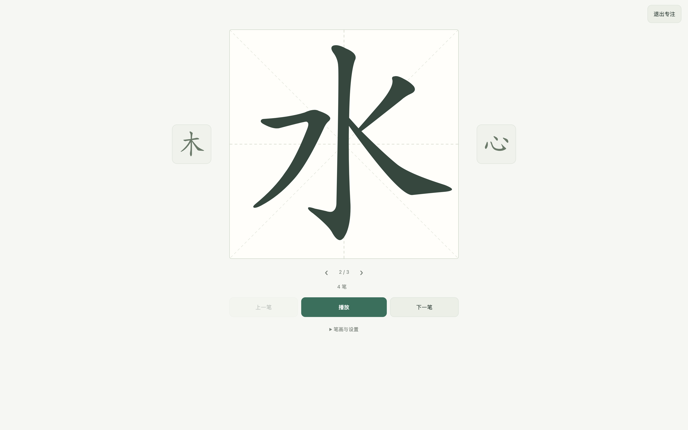

# Web 浏览器与真机验收

日期：2026-11-08。用户选择 iPhone／iPad Safari 优先。验收入口为 `/preview/index.html`，基线功能提交 `2f25a3d`。本文记录步骤和实际结果，未完成项不计作通过。

## 本轮状态

| 环境 | 已确认的信息 | 实际验收状态 |
|---|---|---|
| CDP Chrome | Browser.getVersion：156.0.8078.81 | 已完成下述桌面技术检查；不等于 Safari／iOS 通过 |
| macOS Safari | 应用包版本 27.0.1 | 用户已从本轮验收范围移除 |
| macOS Firefox | 应用包版本 142.0.1 | 仅发现安装，尚未执行 |
| macOS Edge | 应用包版本 157.0.4341.42 | 仅发现安装，尚未执行 |
| iPhone／iPad Safari | 用户已指定为优先真机 | 设备型号、系统版本和实际浏览器结果待记录 |
| 内置浏览器 | 既有布局、播放与故障检查见 W4 记录 | 独立证据，不代替上述浏览器或移动真机 |

Safari／Firefox／Edge 版本来自本机应用包 Info.plist，不代表已启动并测试。初始 Chrome／Safari 电脑控制入口均未获准；随后用户明确授权使用 CDP，并将可用地址更正为 `127.0.0.1:9223`。本轮通过该接口执行 Chrome 验收，实际版本为 156.0.8078.81，与先前本机应用包盘点的 .80 分开记录。未修改浏览器安全设置，也未将 Chrome 结果算作 Safari 结果。

## 准备

桌面使用实际生产构建：

```bash
npm run build
npm run preview -- --host 127.0.0.1 --port 4173 --strictPort
```

访问 `http://127.0.0.1:4173/preview/index.html`，先在“笔画与设置”恢复默认设置。首次媒体启用应从新测试浏览器配置／新来源开始，记录是否存在旧的网站声音权限。不要以开发服务器页面代替这次生产入口。

iPhone／iPad 需能访问同一构建。可由测试者在同一局域网启动：

```bash
npm run preview -- --host 0.0.0.0 --port 4173 --strictPort
```

Safari 打开 `http://<Mac 的局域网 IP>:4173/preview/index.html`。手机中的 `127.0.0.1` 指向手机自身。上述 4173 命令是手机验收示例。本轮 Chrome/CDP 使用临时静态服务 `http://192.168.6.169:5188/preview/index.html`，服务日志中的客户端为 `192.168.6.177`；测试结束已停止服务，未修改防火墙。记录 HTTP／HTTPS、声音输出方式及全屏 API 是否可用；HTTP 上仅出现专注兜底不能据此认定 HTTPS 下的原生全屏行为。

每台设备记录型号、系统版本、浏览器版本、访问地址／协议、网络与测试日期。音量和输出设备可听后再判断播放；不把点击 play 的时间当成实际起音时间。

## 固定验收用例

| 编号 | 操作 | 期望与观察重点 |
|---|---|---|
| B01 首次语音 | 查“木”，查询后先不操作，再选听讲解并点击播放 | 查询后不自动出声；每笔名称只播一次；4 笔结束，无重复声音和残留动画 |
| B02 关闭／重开声音 | 播放“心”时关闭语音，再开启 | 旧录音立即停止，动画继续；从下一笔发声，不补播旧名称；声音被阻止则明确提示，能静音继续 |
| B03 中断续播 | 查“木水心”，播放中暂停，再继续；定位到第 2 笔，重播本笔 | 保留完成笔，中断笔从笔首重播；定位静音，重播本笔不继续到下一笔 |
| B04 快速切字 | 播放中连续下一字、上一字，最后停在“水” | 当前字／笔数与画布一致，旧字和旧录音不继续推进；再查询“家我线”时无旧结果回写 |
| B05 后台恢复 | 听讲解播放中切到其他标签／App，另测锁屏；20 秒后回来 | 回来保持暂停，不自行出声；用户点继续后重播中断笔，未跳笔。标签切换、App 切换和锁屏分别记录 |
| B06 手机输入 | 查询后重新点输入框，用中文输入法改词、确认候选和提交；收起键盘 | 确认输入法候选不误提交；未提交的编辑不改变结果；输入框／查询按钮可达，收起后播放控制可达 |
| B07 旋转与分屏 | 播放／暂停时横竖屏切换，iPad 另测分屏 | 画布居中，无横向溢出，候选渐隐；进度不重置，主要控制可达。窗口缩放不计作设备旋转 |
| B08 全屏进出 | 从设置进入全屏书写，播放、切字、退出；桌面另按 Esc | 退出入口可见，返回原页面与设置焦点；无重复播放。分别记录原生全屏和专注兜底，不混记 |
| B09 20 字整组 | 查“木水心木水心木水心木水心木水心木水心木水”，启用整组，从头播放 | 共 20 字，按序保留重复字；暂停继续、变速和完成重播均能用；不能只检查最后的 20/20 文本 |
| B10 保存与删除 | 收藏“木木水”和当前字，刷新；清空历史；复查收藏；播放时删除该收藏 | 收藏仍在；复查不自动播放，重复字顺序保留；删除不打断当前查询，最后一项删除后焦点可用 |

首次语音、后台恢复、软键盘与原生全屏必须以对应真实浏览器／设备观察为准。资源失败另用 [W4 故障服务器](Web稳定性验证.md)复现，不把该服务器的坏录音当成正常媒体验收。

## 记录格式与出口

每个用例记录：设备与环境、编号、通过／失败／未测、复现操作、期望与实际、截图或录屏、发现的问题和修复后复测结果。Chrome 的实际结果见下表；桌面 Safari 已由用户移出本轮；Firefox、Edge 及 iPhone／iPad 真机仍未执行。

桌面 Chrome 已执行本轮检查；接下来完成代表性 iPhone 与 iPad Safari，再补 Firefox／Edge。桌面 Safari 不再纳入本轮。出现跳笔、旧声音、无法继续或关键操作不可达时先修复并复测；录音试听、弱网与实际音画偏差测量继续单独验收。真实浏览器授权和真机条件未就绪前不替换首页或宣布稳定版。


## Chrome/CDP 实测结果

采用 `Target.createBrowserContext` 创建独立会话，通过 CDP 的真实鼠标／键盘输入操作页面。未使用自动播放豁免、声音权限覆盖、焦点仿真或关闭浏览器安全限制。测试结束处置该会话，仅关闭本轮新建的测试标签，已有用户标签页不变。

| 用例 | 结果与范围 |
|---|---|
| B01 | 首次查询“木水心”停在完整字形、不自动播放；用户手势选听讲解后，“木”完成 4/4，录音等待结束、动画层归零，页面未显示声音失败。媒体流程通过，实际扬声器读音与可听起音未验收 |
| B02 | 在“水”的第一笔中关闭语音，动画仍推进；重新开启后整字完成，无媒体错误提示。实际声音重叠与停声延迟尚未做录音测量；与计划的“心”字用例分开记录 |
| B03 | 定位第 2 笔再重播本笔，完成后停在 2/4；前台暂停保留完成的 2 笔，继续从第 3 笔开始，未重播整字 |
| B04 | 播放中连续切到水、心，再回水，最终显示水完整字形与 2/3，旧动画层清空；随后新查询与连播均未被旧结果回写 |
| B05 | 激活本轮另一个空白标签，原页实际进入 hidden，立即显示继续、前缀 0、动画层 0；至少 20 秒后仍暂停，返回 visible 不自行恢复，点击继续从中断的第 1 笔重新播放。仅标签切换通过，App 切换和锁屏未测 |
| B06／B07 | 手机软键盘、输入法、设备旋转与 iPad 分屏未测；未将 CDP 桌面视口作为手机证据 |
| B08 | 点击全屏后 `document.fullscreenElement` 实际非空，宽度由 1200 变为 1680；退出按钮与 Esc 均可退出，设置重新展开、焦点返回全屏入口。全屏内续播、切字和退出后结果一致 |
| B09 | 快速看、5 档速度、静音下完成两组各 20 字；第一组 80 笔，加入家／我／线的第二组 119 笔，逐字序号与逐笔序列均连续，未跳笔或插入重复笔。此项不证明 20 字录音一致性或全库教学准确 |
| B10 | 收藏“木”及“木木水”，清空历史再刷新，两项仍在；复查保留重复字和 1/3 次序；播放中删除整组，动画继续到下一笔。删除最后一项后字单隐藏、焦点回输入框，当前查询保留 |

两组字单分别为“木水心木水心木水心木水心木水心木水心木水”和“木水心家我线木水心家我线木水心家我线木水”。通过 MutationObserver 观察实际页面的画布可访问名称，记录每次“正在书写第 N 笔”，并独立按字笔数核对；未读取控制器私有状态，也未仅凭终点 20/20 判断。结构化序列保存在 [Chrome 逐笔记录](验收记录/Chrome-CDP-2026-11-08.json)。这属于 UI 状态顺序证据，不是每帧绘制或实际可听起音测量。

首次服务日志出现 `/favicon.ico` 404；字库、页面、脚本及实际录音请求正常，未将缺失图标计为播放失败。尚未完成生产托管缓存、HTTPS 和发布回退验收。本轮未修改运行时代码，不扩大为全浏览器通过结论。

原生全屏截图（实际 Chrome，不是专注兜底）：




## iPhone／iPad 手动验收

桌面 Chrome/CDP 接口不能用于控制 iPhone／iPad Safari。当前采用真实设备手动测试并回传结果；没有要求安装 App、证书或描述文件。

在与 Mac 同一局域网的设备上，用 Safari 打开 `http://192.168.6.169:5188/preview/index.html`。这是临时生产构建预览，Mac 服务必须保持运行；地址会随 Mac 网络变化。2026-11-08 用户准备测试后已重新启动该服务，测试结束再关闭。手机不要使用 `127.0.0.1`。若打不开，先记录 Safari 的错误文本与设备是否同一 Wi-Fi，不通过调整手机浏览器安全设置来绕过。

每台设备先做这六步，约 3—5 分钟；iPhone 与 iPad 分别记录：

1. 查“木水心”，保持默认设置：应先显示完整字形，不自动播放。输入法确认候选时应不误提交。
2. 展开设置，选听讲解并点播放：检查“木”的 4 笔名称是否清楚，每笔只播一次；记录无声、重叠或明显错位。
3. 播放中切到其他 App，20 秒后返回；另做一次锁屏／解锁。两次都应保持暂停，点击继续才恢复，并从中断笔起点重播。
4. 播放中快速切字，最后停在“水”：应显示水，旧字／声音不继续。点第 2 笔再重播本笔，应停在 2/4。
5. 打开软键盘改查“家我线”，检查输入和查询按钮可达；收起键盘，横竖屏切换后检查画布、候选队列和播放控制。iPad 额外做 Safari 分屏。
6. 进入全屏书写再退出。记录进入的是浏览器原生全屏还是页面内专注布局；两种均须有可用退出入口。收藏一个字和一组字，刷新后复查。

回传格式：`设备型号 / iOS 或 iPadOS 版本 / 步骤编号 / 通过或异常 / 实际现象`。出现问题时保留该字、笔号和当时操作顺序；必要时提供录屏用于定位。正常运行的录屏不能代替音画偏差 p95 测量，完整的 20 字、弱网与录音试听继续按固定用例执行。
