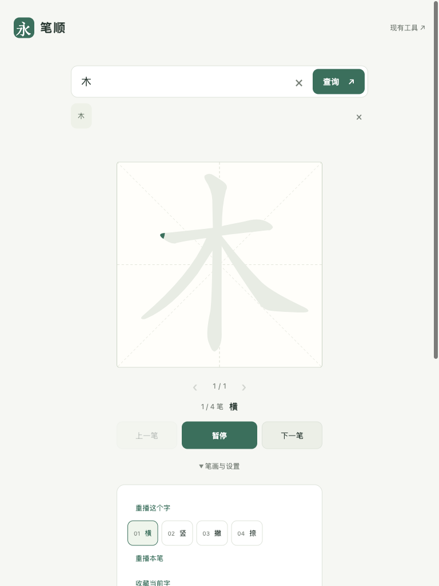

# Web 稳定性验证（W4，进行中）

日期：2026-11-08。第一批完成生产构建的资源故障验证和对应修复，保留已确认界面。没有替换首页或部署，尚未完成 W4 全部验收。

## 已修复

- 整组切字加载时暂停，数据到达后定位到第 N 笔，继续播放曾错误地从首笔开始。现在定位会清除旧的加载续播位置；明确重播也不继承旧位置。新增回归先复现失败，再验证只播放定位后的笔画。
- 当前字加载失败后，后台预取曾自动重试并清掉错误原因，而主界面仍显示失败。现在预取只处理未加载且未失败的字；失败原因保留到用户重试，避免页面状态与数据脱节。新增回归验证请求次数、错误保留和手动重试。
- 损坏录音解码失败曾直接显示浏览器英文错误。现统一为“录音无法播放，已静音继续”；声音上下文无法启用也给中文提示。书写继续完成，不把媒体故障升级成整字失败。
- 重复构建曾在 Vite 清理上万份旧字形文件时出现 `ENOTEMPTY`。`tools/build.mjs` 现在只清理固定的生成目录 `dist/`，使用 Node 的有限重试（最多 3 次、100ms 递增间隔），再执行 Vite 构建。清理最终失败仍退出，不保留旧资源混入新版本。修改后连续两次构建及最终修订后的构建通过；尚未确定本机出现该暂时性错误的底层原因。

## 生产构建故障检查

用实际 `dist/preview/index.html`，通过仅绑定本机的测试服务器注入 HTTP 故障。网站源码没有测试开关或调试入口。

```bash
npm run build
node test/serve-fault-preview.mjs       # 默认 5187；可追加其他端口
```

打开终端显示的 `/preview/index.html`，依次查询下列单字。服务器不缓存响应，重启会重置故障计数；此测试服务故意损坏响应，不能作为正常预览或部署服务。

| 测试 | 注入故障 | 内置浏览器观察 |
|---|---|---|
| 木 | 首次字形请求返回 404 | 显示“资源请求失败（404）”，禁用播放；点击重试恢复完整字形 |
| 水 | 首次 JSON 路径返回 HTML | 显示“资源返回了非 JSON 内容”；点击重试恢复，不把 HTML 当成就绪资源 |
| 心 | 首次响应延迟 5.5 秒 | 客户端显示“资源加载超时，请重试”，退出加载；点击重试恢复 |
| 心，听讲解 | 所有 MP3 返回不可解码字节 | 中文提示静音继续，仍完成 4/4 笔，主按钮变为“重播” |

复核对象是修复后的生产入口与实际 HanziWriter／Web Audio，未以开发服务器的路由回退代替生产资源。故障控制台中的预期 404 不计作无异常；本轮也不宣称控制台完全无错误。

`npm test`：48 字／233 笔样本及 34 项 Node 回归通过。构建、录音技术校验、修改文件语法与 diff 空白检查通过。390px 窄屏检查了静音降级后的完成画布和中文提示。

## 第二批：偏好与专注书写

新增入口均在“笔画与设置”中，常态主界面不增加按钮：

- 节奏、五档速度、语音、整组、格线与轮廓保存在 `bishun-web-preferences-v1`。读取仅接受已知字段、合法枚举／范围和布尔值；坏 JSON 或存储受限回到默认值，当前操作仍可用。
- 刷新后恢复偏好，不恢复播放任务，也不自动请求声音解锁。点击播放／语音相关操作后才按原有用户手势解锁声音。
- 恢复默认设置会暂停当前播放，恢复快速看、正常速度、静音、单字、格线与轮廓；不删除查询历史。
- 全屏书写收起搜索、页眉、页脚和展开设置，放大画布，保留队列与播放控制。支持时由用户点击尝试浏览器原生全屏，否则使用同一套可滚动专注布局。退出按钮固定可见，支持 Esc；退出恢复原设置展开状态与入口焦点。全屏状态不持久化。

`npm test` 当前为 48 字／233 笔样本和 **36 项 Node 回归**通过；新增偏好校验、重载、重置不清历史和存储异常覆盖。语法、diff 与生产构建检查通过。

生产页内置浏览器检查：跟写／极快／整组／关闭格线与轮廓在刷新后保留；语音勾选刷新后保留，当前字仍显示完整字形、按钮为播放；恢复默认后的控件值和画布恢复。进入专注模式后搜索隐藏、设置收起，Esc 和退出按钮均可返回，焦点回到全屏入口。专注模式中切字、播放、暂停、继续和完成可用。320×820 视口画布中心 x=160，页面宽和 scrollWidth 均为 320；640×360 时两者均为 640，退出按钮可见，短视口允许纵向滚动。最终检查未见控制台 error／warn。

该环境实测 `document.fullscreenElement` 为空，因此只验收了专注布局兜底，**原生系统全屏进出仍待真实浏览器验证**。没有用专注模式冒充原生全屏通过。

## 第三批：本地收藏字单

- “笔画与设置”提供收藏当前字和收藏这组字。保存对象为当前查询快照，保留词序与重复字，不读取输入框尚未提交的编辑内容。单字查询只显示一个收藏入口，已收藏项禁用重复保存。
- 输入框下提供折叠的“我的字单”，没有收藏时不显示。可从空白查询页直接复查，点击后按普通查询加载，不自动播放；逐条删除不改变当前查询或打断播放。
- 使用独立键 `bishun-saved-queries-v1`，最新收藏在前，最多 30 条；满额拒绝新增并提示删除旧项，不静默淘汰。字单不随历史清空、查询清空或设置重置删除。内容仍按当前字库校验，收藏不表示字形或名称已经审核。
- 共享历史的汉字／长度校验，坏数据会过滤，坏 JSON 或存储受限仍可操作；保存／删除写入失败有明确提示，避免把仅会话内变更称为持久保存。列表用文本节点显示，长字单换行；删除后焦点移到邻项，最后一项删除后回到输入框。

`npm test` 当前通过 48 字／233 笔样本和 **39 项 Node 回归**。新增测试覆盖收藏持久化、重复查询去重、查询内重复字保留、历史隔离、30 条容量不淘汰、非法内容与存储失败；构建、语法及 diff 检查通过。

生产页内置浏览器复核：查询“木木水”后把输入框改为“春风”，收藏仍为“木木水”；分别收藏当前“木”与整组，已收藏按钮禁用。清空历史再刷新，两条收藏仍可从输入前页面复查。播放中删除“木木水”，木的动画继续，当前结果仍为 1/3；最后删除“木”后字单入口隐藏、焦点回到输入框。收藏 20 字长词和单字后，恢复默认不删除收藏；320×820 视口下长词换行，实际内容宽度／scrollWidth 均为 305（扣除滚动条），画布中心 x=152.5。最后控制台未见 error／warn。

## 第四批：真实浏览器验收启动

用户指定 iPhone／iPad Safari 优先，已整理 [浏览器与真机验收步骤和结果表](Web浏览器与真机验收.md)，覆盖首次语音、后台／锁屏恢复、软键盘、快速切字、原生全屏和 20 字连播。本轮重新构建生产入口通过，资源／录音前置校验通过。

已盘点本机 Chrome、Safari、Firefox、Edge 应用版本；Chrome 与 Safari 的电脑控制请求均返回“未获准使用”，真实浏览器操作尚未执行。没有把应用已安装、控制器回归或既有内置浏览器结果计作真机通过；局域网服务尚未启动，未改动网络设置。

## 第五批：Chrome/CDP 实测

用户提供可用的 `127.0.0.1:9223` 后，已通过独立 CDP 会话完成 Chrome 156.0.8078.81 的媒体流程、暂停定位、快速切字、标签后台 20 秒恢复、原生全屏进出和收藏检查。两组 20 字快速静音连播实际记录 80／119 笔连续序列，含重复字与家／我／线；记录不代替逐笔录音审核。此前“未获准使用”的本机应用控制限制仍为历史事实，但不再阻塞这个用户指定的 Chrome/CDP 通道。

详见 [真实浏览器结果表](Web浏览器与真机验收.md#chromecdp-实测结果)及 [逐笔序列](验收记录/Chrome-CDP-2026-11-08.json)。Chrome 原生全屏已实测，iOS 的原生全屏、手机键盘、App 后台／锁屏与声音实听仍待验收；没有把 Chrome 或标签切换结果平移成手机通过。本轮只更新验收证据，没有新增功能或替换首页。

## 第六批：iPad 动画偏移与 iPhone 静音模式无声

用户真机反馈：iPadOS 26.7.2 播放时动画不在米字格内；iOS 27.0.1 已启用语音，但打开系统静音时无声，关闭静音后声音恢复。以上版本来自用户提供，设备型号仍未记录。

**动画根因与修复：** HanziWriter 使用 1024 单位的坐标，旧适配器只通过 CSS 改 SVG 显示宽高，生成的 SVG 没有 `viewBox`，路径未按显示区域正确缩放。这是通用的坐标缺陷，不只影响 Safari。现在直接提供 `viewBox="0 0 1024 1024"` 的 SVG 容器，保留相同的坐标原点与纵轴变换；画布缩放时由 SVG 映射静态字形与当前笔。

先前 Chrome 的 80／119 笔记录只证明状态顺序及最终字形，遗漏了播放中的几何检查，不能用来证明动画位置正确。新增可复现的实际浏览器回归（Node 22+，不进入普通 npm test）：

```bash
node test/browser-geometry.mjs http://127.0.0.1:9223 http://192.168.6.169:5188/preview/index.html
```

该脚本创建独立 CDP 会话，以真实输入触发动画，比较静态笔画组与动画笔画组的屏幕坐标矩阵；结束后关闭自建会话。三种视口 1024×820、768×1024、320×820 的最大矩阵差为 0；临时移除 viewBox 的反例产生约 585／733 的差值，确认测试确实能检出旧问题。[矩阵记录](验收记录/animation-geometry-2026-11-08.json)是 Chrome 结果，不冒充 iPad 修复复测。

**声音根因与修复：** 用户明确确认了静音开关这一触发条件，与 [WebKit 的 Web Audio 记录及 playback 会话处理说明](https://bugs.webkit.org/show_bug.cgi?id=237322)一致。语音启用时，在创建／恢复 AudioContext 前显式设置可用的 `navigator.audioSession.type = 'playback'`，表达主动播放媒体的用途；继续由用户点击触发，不改变默认快速看的静音设置，也不播放循环静音文件。API 缺失或不支持设置时，保留原有播放流程。接口性质见 [W3C Audio Session 工作草案](https://www.w3.org/TR/audio-session/)，不能据此宣称所有旧版 iOS 都支持。

`npm test`：48 字／233 笔样本、**41 项 Node 回归**通过；新增会话类型先于上下文创建／恢复、可选 API 失败不阻塞声音的覆盖。生产构建及语法／diff 检查通过。最终构建在 Chrome 中播放木完成 4/4、动画层归零、无页面媒体失败提示；该 Chrome 未提供 audioSession API，验证了不支持该 API 的兼容路径。

**真机复测结果：** 2026-11-08 用户确认“刚才的问题都解决了”，iPad 动画偏移、iPhone 静音开关下无声两项缺陷已关闭，修复提交为 `f75d8e1`。测试入口为 `/preview/index.html?v=ios-fix-1`。这是用户提供的真机结果；横竖屏、全屏、后台／锁屏、网站语音关闭即停等其他用例没有随之自动标记通过。



## 第七批：模拟弱网、断网与恢复

使用 Chrome 156.0.8078.81 的独立 CDP 会话，测试已加载的生产页面。只对测试会话模拟网络，关闭浏览器 HTTP 缓存；保留并验证应用自身的内存字库与解码录音缓存。没有操作既有用户标签、修改系统网络或安装代理。

新增复现命令（Node 22+，需已授权的 CDP 与可访问的生产预览）：

```bash
node test/browser-network.mjs http://127.0.0.1:9223 http://192.168.6.169:5188/preview/index.html
```

| 场景 | 结果 |
|---|---|
| 冷字库：400ms 延迟、50,000 字节/秒下载 | 查询木约 2,135ms 后可用；这是单次查询，不是首屏加载或 p95 |
| 同页缓存木，切断网络再查询 | 完整字形可用，新增资源请求为 0 |
| 断网查未缓存的花 | 显示中文网络连接失败，退出加载；恢复网络后点重试可用 |
| 冷清单：1,000ms 延迟、10,000 字节/秒 | 约 3,103ms 后明确超时；恢复网络后重试心成功 |
| 慢查询学，随后改查木 | 晚到结果未覆盖木 |
| 阻断录音资源 | 中文提示可静音继续，木仍完成 4 笔 |
| 恢复录音请求并重新查询 | MP3 请求 200，完成播放且无媒体失败提示 |
| 已缓存木与解码录音后断网 | 完成 4 笔，新增字形／录音请求为 0 |

以上拆分为 **10 项浏览器检查**，完整结果见 [网络报告](验收记录/network-2026-11-08.json)。这里只验证已加载页面内的缓存复用，不承诺断网刷新、离线冷启动或完整离线字库。测试不含真实移动网络切换、丢包或实际声音延迟。

首次回归复现了断网时直接显示英文 `Failed to fetch` 的问题。现在字形网络错误、坏 JSON 以及录音网络错误转换为中文提示，并保留超时／校验失败各自的原因；失败后的重新请求可恢复。新增对应 Node 回归，当前 `npm test` 为 48 字／233 笔样本及 **43 项**通过。生产构建通过，共用隔离 CDP 辅助代码后的三尺寸坐标回归也保持通过。

另生成了不改变资源的 26 条录音试听串与 [逐条清单](笔画录音试听清单.md)，时长约 38.82 秒；原文件哈希核对并解码，未重新调用 TTS。人工读音与截断试听仍待确认，所有录音状态继续保留 `pending-listening`。

## 第八批：录音试听确认

2026-11-08 用户试听 26 条原录音拼接的 38.82 秒试听串后确认“试听没问题”。本批原 MP3 未修改，manifest 的全部 26 项标记为 `reviewed`，逐项记录审核日期与 `user-confirmed-listening-reel` 方法。校验依据仍为原文件 SHA-256；重新生成同哈希文件时制作脚本会保留既有审核记录。

录音听感确认与全字库笔画名称教学准确性、真实设备音画偏差的测量分别记录，不扩大审核范围。

## 第九批：性能采样准备与构建完整性

提供 `test/browser-performance.mjs`，计划对缓存查询、切字、动画启动和暂停各采集 30 次，输出原始样本与最近秩 p50／p95。计时从浏览器可信 click 捕获事件开始，到预期 DOM 状态与随后 requestAnimationFrame；不包含输入文字／滚动，不是实际屏幕呈现、声音停止或可听起音测量。浏览器 HTTP 缓存关闭，应用字库预热后应没有新增字形请求。

```bash
node test/browser-performance.mjs http://127.0.0.1:9223 http://192.168.6.169:5188/preview/index.html
```

当前三轮尝试均因测试页转入 hidden 而作废。最后一轮只完成 3 个查询样本，窗口仍为 normal 状态；显式激活测试标签和将测试页置前后仍发生后台切换，不能报告有效 p50／p95，也不将此误记为产品响应超预算。脚本保留前台可见性校验，不用可见性／焦点仿真绕过。环境结果见 [未完成采样记录](验收记录/performance-2026-11-08.json)，需 CDP 对应窗口实际保持前台后重测。

录音审核更新后的生产构建通过。另逐项核对 dist：9,574 个字形 SHA-256 与来源清单一致，26 份录音哈希与审核状态一致，原许可／来源说明／清单完整复制，两个入口引用的脚本与样式文件存在。这些构建完整性检查不表示已经部署或完成缓存刷新验收。

## 尚未完成

- Firefox／Edge 和代表性 iPhone、iPad、Android 真机，软键盘、横竖屏与后台／恢复。用户已将桌面 Safari 移出本轮验收。
- 真实手机弱网、网络切换／丢包、未加载应用时的完整断网与首屏资源下载、媒体授权被阻止及可听起音偏差。当前 CDP 模拟和同页缓存检查不代表这些场景已经通过。
- 全字库内容审核与 W2 已记录缺字／名称冲突；本批 26 份录音的用户试听已通过。
- p50／p95 查询、切字、取消及音画偏差目标；没有用 API 调用时刻冒充真实起音。
- 原生全屏的设备兼容性验收及必要的发布检查。验收完成后再决定首页替换。
