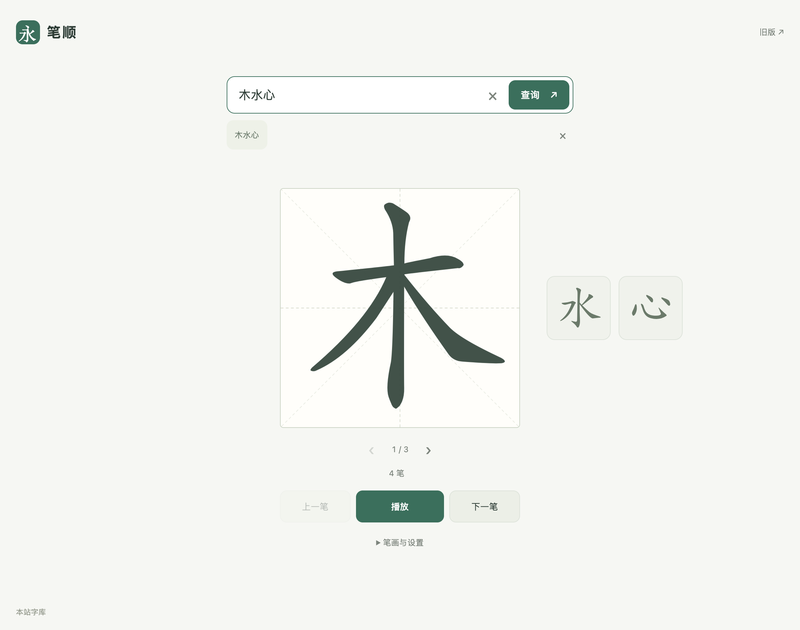

# Web 首页切换候选版

日期：2026-11-08。用户授权准备首页切换候选版；本地默认入口已调整，尚未部署或替换线上站点。

## 入口与保留范围

| 地址 | 行为 | 源码 |
|---|---|---|
| `/` | 新版默认首页 | 根目录 `index.html`、`src/web/`、`src/playback/` |
| `/preview/index.html` | 前端 replace 跳到 `/`，保留 query 与 hash；禁用脚本时有链接可点 | `preview/index.html` |
| `/legacy/index.html` | 保留旧版独立入口，页脚可返回新版 | `legacy/index.html`、原 `src/main.js` 和 `src/style.css` |

Vite 明确构建三个 HTML 入口，兼容地址不再维护第二份新版 UI。跳转是静态页面中的前端替换，不是服务器 301，也不依赖托管平台的 SPA 路由回退。按站点根目录部署，原有字库和录音绝对路径保持一致。

新版页首提供“旧版”链接，标题调整为汉字笔顺查询，复用已有图标；已确认的输入框、居中画布和两侧候选布局不变。原版页面及统计脚本保留，除返回链接外没有重新设计旧版。原先未提交的 `src/main.js` 与 `public/hanzi-writer-data/` 是既有用户改动，本轮没有覆盖或纳入提交；本机旧版构建继续使用当前工作区的源码与资源。

历史、字单和新版偏好的存储键均未改动；路径从预览切到首页仍在同一来源，因此无需复制或清空数据。旧版自己的速度与语音设置保持独立。跨域名部署后的存储迁移不在本次范围。

## 已验证

- `npm test`：48 字／233 笔样本、43 项 Node 回归通过。
- 生产构建输出 `dist/index.html`、`dist/preview/index.html`、`dist/legacy/index.html`。新旧入口引用的 JS／CSS 均存在，图标匹配；9,574 个字形 SHA-256、完整许可／来源清单、26 份已审核录音与 manifest 一致。
- Chrome 156.0.8078.81、独立 CDP 会话完成 9 项入口检查。新版从 `/` 启动；木的声音／动画完成 4 笔、活动坐标与静态字形一致；重播第 2 笔后停在 2/4。
- 收藏木和木水心后访问旧预览地址 `?candidate=1#query`，实际落到 `/?candidate=1#query`；两项收藏和语音偏好保留，不自动播放，收藏复查为 1/3。
- 新首页桌面 1280、平板尺寸 768、窄屏 320 的视口检查无横向溢出，画布中心分别为 640、384、160。这里只是桌面视口检查，未算作新增真机验收。
- 新版加载资源全部同源。进入旧版后检查原界面和构建信息，确认旧模块已初始化；返回新版后收藏仍保留。回归时阻断旧版统计服务请求，没有删除其原有脚本。

完整结果见 [入口验收记录](验收记录/home-entry-2026-11-08.json)。复现命令（Node 22+、已授权 CDP、生产预览服务）：

```bash
node test/browser-entry.mjs http://127.0.0.1:9223 http://192.168.6.169:5188/
```

## 发布范围与待完成项

当前可以审查默认首页候选并通过独立入口回到旧版；没有推送、部署、修改 DNS／托管路由，也未验证线上缓存刷新或服务器回滚。实际部署前应保留现有线上构建与资源版本。

已有通过记录：录音试听、iPad 动画偏移与 iPhone 静音播报两项真机修复、Chrome 核心交互、模拟弱网／同页缓存恢复、桌面 DOM 响应采样。保留 [W4](Web稳定性验证.md) 中的范围限制：其余设备／浏览器、手机后台／锁屏与键盘／分屏完整用例、真实音画偏差与网络切换、全字库内容缺口仍未全面验收。旧版保留入口不意味着旧播放逻辑获得新版的稳定性承诺。


